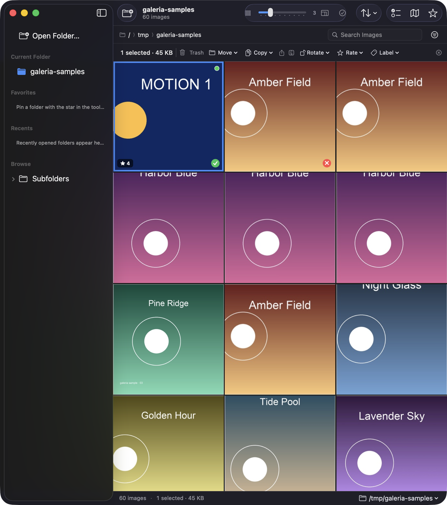
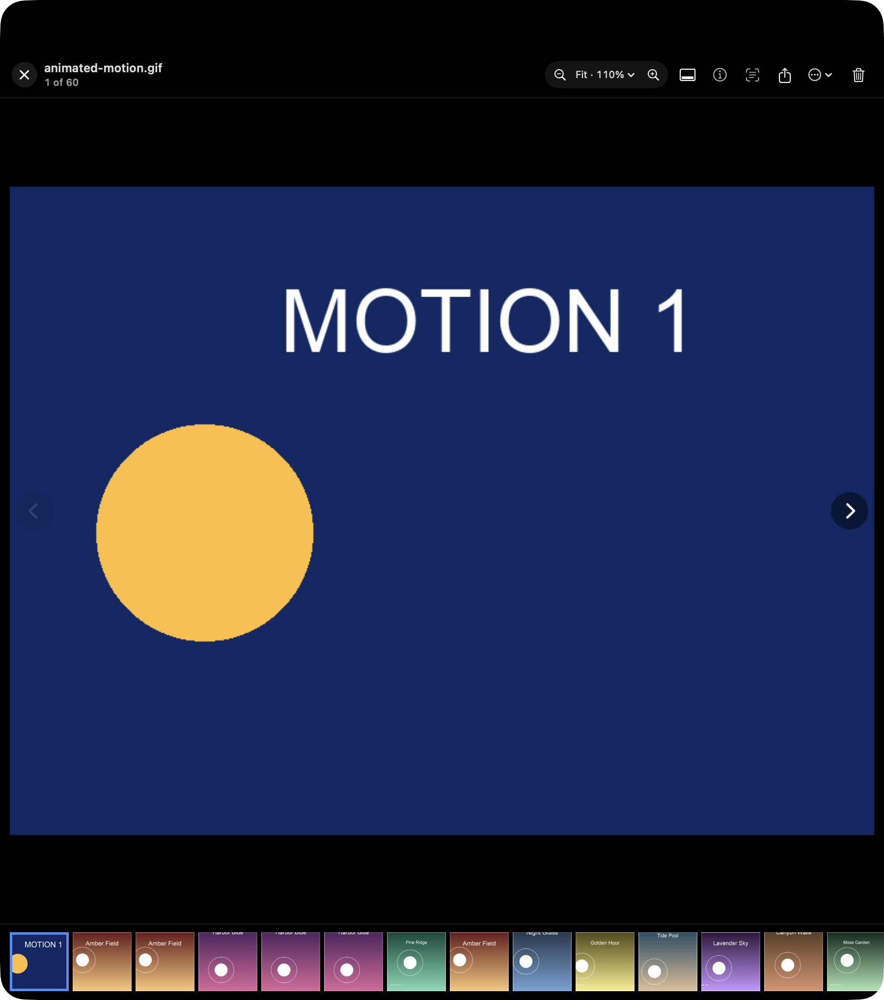

# Galeria

A fast, keyboard-driven image browser for macOS. Pick a folder, browse it as an adjustable Instagram-style grid, preview images with Live Text, cull, tag, compare, find duplicates, rename or export in batches, and drag real files straight out to Finder or a browser upload zone.

Galeria is built with SwiftUI for the shell and an `NSCollectionView` for the grid. It uses only Apple frameworks and stores preferences in `UserDefaults`; there is no database and no network service for library data.





## Requirements

- macOS 14.0 or later (deployment target: 14.0)
- Xcode 16 or later (the checked-in project builds with Xcode 27.1)
- No third-party dependencies

## Build & run

The project is a normal Xcode project with a shared `galeria` scheme.

```bash
# Build
xcodebuild -project galeria.xcodeproj -scheme galeria \
  -configuration Debug -derivedDataPath .build/DerivedData \
  -destination 'platform=macOS,arch=arm64' build

# Run the built app
open .build/DerivedData/Build/Products/Debug/galeria.app
```

To build a signed Release app:

```bash
xcodebuild -project galeria.xcodeproj -scheme galeria \
  -configuration Release -derivedDataPath .build/ReleaseDerivedData \
  -destination 'platform=macOS,arch=arm64' build
```

### Sandbox

The app is sandboxed. Entitlements are in `galeria/galeria.entitlements`:

- `com.apple.security.app-sandbox`
- `com.apple.security.files.user-selected.read-write`
- `com.apple.security.files.bookmarks.app-scope`
- `com.apple.security.network.client` (MapKit tiles only)

Every folder is accessed through a security-scoped bookmark. Read access is held from the moment the folder opens until the folder session ends. Stale bookmarks are refreshed, and a failed bookmark resolves to a clear recovery message rather than a blank window.

## Features

### Browsing

- **Folder access** from a toolbar button, `⌘O`, a folder dropped on the window, or a folder dropped on the Dock icon.
- **Live folder watching** with FSEvents, debounced so a burst of writes becomes one update. Added, removed, renamed, and modified files update the grid with animation while selection and scroll position are preserved.
- **Adjustable grid** from 1 to 10 columns with a toolbar slider and trackpad pinch. Square-cropped tiles use 2 px spacing. Default density is 3 columns.
- **Original aspect ratio** mode uses a justified-rows custom `NSCollectionViewLayout`.
- **Breadcrumb path bar**, clickable status-bar path, and `⌘↑` for the enclosing folder.
- **Persistence** in `UserDefaults` only: last folder bookmark, per-folder density and sort/grouping, window frame, preview preferences, and all settings.
- **Sidebar** with favorites, recents, and an optional collapsible subfolder tree. Sidebar folders, including subfolder rows, are drop targets for moving selected images.
- **Empty and error states** for no folder, an empty folder, no filter matches, a missing folder, and lost permission.

### Sorting, filtering and search

- Sort by name, date taken (EXIF with creation-date fallback), date modified, date added, file size, dimensions, or format; ascending or descending.
- Filter by file type, orientation, minimum width/height, rating, Finder color label, and Pick/Reject flag.
- Search filenames and, when enabled, Vision content labels. `⌘F` focuses search. Active filters appear as chips with **Clear All**.
- Group by none, day, or month with sticky section headers.

### Selection and file actions

- Native click, Shift-click range, Command-click toggle, Command-A select all, click-empty deselect, and drag-marquee selection.
- A **Select mode** toggles checkmark selection without modifiers. A selection action bar exposes Trash, Move, Copy, Share, Reveal, Compare (2–4 selected), Rotate, Rate, Label, and Clear.
- Trash uses `NSWorkspace.recycle` and never permanently deletes. Confirmation appears only above the configurable threshold (default 10). Undo restores files from the `recycle` URL mapping; redo re-trashes where possible. Selection advances the way Finder does.
- Move/Copy to a chosen folder or a saved favorite/recent destination. Number-key quick-move shortcuts are available on Move destinations (`⌥⌘1`–`⌥⌘9`). Existing files are never overwritten; duplicate names receive a numeric suffix.
- Full context menu: Quick Look, Open in Default App, Open With, Reveal in Finder, Copy, Copy as Image, Share, Info, Move/Copy, Rotate, Pick/Reject, Rating, Label, and Move to Trash.
- Ratings, flags, and color labels are written to Finder tags (`Rating 4`, `Pick`, `Reject`, `Red`, etc.) so they are visible in Finder and survive relaunch. Tile overlays can be hidden in Settings.
- Batch rename with tokens (`{name}`, `{counter}`, `{date}`, `{camera}`), counter start and padding, live preview, collision detection, two-phase renames, and undo.
- Batch export/convert to JPEG, PNG, or HEIC with quality, maximum dimension, strip-metadata, safe unique naming, progress, and cancellation.
- JPEG rotation is lossless when the file has a writable EXIF orientation; otherwise the app warns before re-encoding at highest quality. RAW and animated GIF rotation are refused to avoid data loss.

### Quick preview

- Opens as an in-app overlay with double-click or Return; Space toggles it; Escape closes it.
- Arrow keys navigate the current sorted/filtered order. Neighbors ±2 are prefetched.
- Trackpad gestures at fit scale: swipe right/left for the previous/next image, and swipe down to close. Once zoomed, two-finger scrolling pans instead.
- Fit/100% zoom via mouse, `+`/`−`, `0`, and double-click; scroll pans while zoomed.
- Animated GIFs play. EXIF orientation is applied consistently in the grid, filmstrip, preview, info panel, compare view, and export.
- Filmstrip with current selection, toggleable with `F`.
- Info panel (`⌘I`) with full file, camera, and GPS metadata and a MapKit map.
- Live Text via `ImageAnalysisOverlayView` (toggle with `L`).
- Preview actions: trash (auto-advance), rotate, rate, label, copy, share, reveal, and drag the image file out.
- Compare 2–4 selected images side by side with synchronized zoom and pan.
- Fullscreen slideshow with a configurable interval, Space play/pause, and Escape to exit.

### Culling, duplicates and smart features

- **Cull mode** opens a full-window review with reviewed count and progress. `P` keeps and advances; `X` rejects and advances. **Review Rejected** lists rejects and can move them to Trash with undo.
- **Duplicate finder** with exact SHA-256 groups and adjustable Vision feature-print similarity. Runs in the background with progress and cancellation; pick one keeper per group and trash the rest.
- **On-device content search** is opt-in in Settings. `VNClassifyImageRequest` labels are cached on disk and only used locally. Search matches both filenames and labels.
- **Photo map** shows geotagged images as MapKit pins; clicking a pin jumps back to the image in the grid.

### Native details

- Full light and dark mode.
- Monochrome SF Symbols, system type styles, native materials, sheets, split view, popovers, context menus, and toolbar.
- VoiceOver labels for tiles include the name, dimensions, rating, flag, and selected state. Tiles expose Quick Look, Move to Trash, and Reveal in Finder accessibility actions.
- Help window with every keyboard shortcut.
- Undo journal for trash, tags, moves, and renames, plus redo.

## Keyboard shortcuts

| Action | Shortcut |
| --- | --- |
| Open folder | `⌘O` |
| Enclosing folder | `⌘↑` |
| Search / filters | `⌘F` / `⇧⌘L` |
| Select all / deselect all | `⌘A` / `⇧⌘A` |
| Toggle Select mode | `⇧⌘S` |
| Quick Look / close preview | `Space` |
| Open preview | `Return` |
| Close preview / slideshow / cull | `Esc` |
| Move to Trash | `Delete` or `⌘⌫` |
| Undo / redo | `⌘Z` / `⇧⌘Z` |
| Rate 0–5 | `0`–`5` (grid) |
| Pick / Reject | `P` / `X` |
| Red / yellow / green / blue label | `6` / `7` / `8` / `9` |
| Previous / next preview image | `←` `↑` / `→` `↓`, or trackpad swipe right / left |
| Close preview | `Esc`, or trackpad swipe down |
| Fit / actual size / zoom | `0` / double-click / `+` `−` |
| Toggle filmstrip / Live Text | `F` / `L` |
| Rotate left / right | `⌘L` / `⌘R` |
| Reveal in Finder | `⇧⌘R` |
| Compare selected | `⌥⌘C` |
| Cull folder | `⇧⌘K` |
| Find duplicates | `⌥⌘D` |
| Photo map | `⌥⌘M` |
| Start slideshow | `⌥⌘P` |
| Export selected | `⇧⌘E` |
| Quick-move destination | `⌥⌘1`–`⌥⌘9` |
| Settings | `⌘,` |
| Keyboard shortcuts help | `⇧⌘/` |

In preview, `0` fits the image; use the Rating menu to clear a rating. In culling, `P` and `X` auto-advance.

## Drag and drop

The grid is an `NSCollectionView`. Dragging any selected tile drags **all** selected files. If the dragged tile was not selected, it becomes the selection. The pasteboard writer returns a real file `NSURL`, and the source operation mask is **copy-only outside Galeria**, so Finder, the desktop, browsers, and Mail copy files rather than moving them out of the library. Use the Move command when you intend to relocate files. The drag image is a stack with a count badge.

Test it manually:

1. Open a folder with at least two images in Galeria and select both.
2. Open a Finder window on the same volume and drag from one selected tile. Both files should be copied as a stack, and the originals must remain in the source folder.
3. Drag to the Desktop. Both files should appear there.
4. Open a browser page with a file drop zone, for example a form containing `<input type="file" multiple>`, or a service that supports dropping multiple images. The selected files should populate the upload control.
5. Compose a new message in Mail and drag the selected tiles into the body. Both images should become attachments.
6. Because drag-out is copy-only, the source folder should still contain every file after the drop. To move files, use Galeria's Move command; its folder watcher will then update the grid.
7. Drag an image from Quick Preview onto the Desktop — the current file is exported as a real file.
8. Drop image files from Finder onto Galeria: they are copied into the current folder without overwriting. Drop a folder to open it. A full-window drop highlight shows the target.

The external-app portion of this checklist requires an interactive WindowServer and Accessibility approval and is not automated in the repository's test suite.

## Architecture

```
galeria/
  Models/        ImageItem, sorting/filtering, selection, Finder tags, undo journal,
                 batch-rename engine, menu state, @Observable gallery model
  Services/      folder scanning/watching, bookmarks, thumbnails, preview images,
                 trash and file transfer, Finder tags, rename/export/rotation,
                 duplicate detection, Vision indexing, subfolder listing
  Views/         app shell, sidebar, browser/filter bar, preview, compare, cull,
                 duplicate finder, rename/export sheets, map, settings, help
  AppKit/        NSCollectionView bridge, custom layouts, tile views, preview canvas
  Utilities/     preference keys/defaults
galeriaTests/    41 Swift Testing tests
```

Design decisions:

- **SwiftUI for the shell, AppKit for the grid and photo canvas.** The collection view provides native multi-selection, marquee selection, efficient reuse, prefetching, and real file drag-out. The preview canvas is AppKit so it can host `ImageAnalysisOverlayView` and handle pinch/scroll/double-click precisely.
- **MVVM with UI-free foundations.** `SelectionModel`, `SortFilterModel`, `BatchRenameEngine`, `ImageScanner`, and all services avoid SwiftUI. `GalleryModel` coordinates sessions, UI state, menus, and undo.
- **Everything expensive is off the main actor.** Folder enumeration, ImageIO metadata and thumbnails, preview decoding, hashing, Vision, export, rename, and file transfers run in actors or detached tasks. The first 12 scanned images stream to the grid before the full folder scan completes.
- **Bounded image memory.** The grid crates only downsampled thumbnails (NSCache + disk cache keyed by path, modification date, and pixel bucket). Full-size preview images are limited to 4096 px and a small LRU-style preview cache.
- **No destructive shortcuts.** Trash, move and rename use preflight collision checks and an undo journal that performs the inverse operation. Nothing is permanently deleted by Galeria.
- **Menus stay fresh.** SwiftUI `Commands` do not observe `@Observable` models, so `MenuState` publishes a tiny equatable snapshot to the app scene; the App rebuilds its command set when selection, preview, or undo state changes.

## Tests

The shared scheme runs the stable Swift Testing unit suite only:

```bash
xcodebuild test -project galeria.xcodeproj -scheme galeria \
  -configuration Debug -derivedDataPath .build/DerivedData \
  -destination 'platform=macOS,arch=arm64' CODE_SIGNING_ALLOWED=NO
```

The 45 tests cover:

- natural name sorting, all other sort keys, filters, grouping, active chips
- selection click/range/toggle semantics and post-delete advancement
- Finder rating, flag, and color-label encoding
- trash/recycle mapping and non-overwriting restore (with a temp provider)
- bookmark record persistence
- batch-rename pattern rendering, collision detection, two-phase swaps
- lossless JPEG EXIF orientation editing
- ImageIO export and unique-name behavior
- image scanning with and without subfolders
- undo/redo journal behavior
- file import collision behavior
- trackpad swipe direction thresholds
- reuse of a larger cached thumbnail when a smaller size is requested

The UI-test target is intentionally not part of the shared scheme: XCUITest could not bootstrap in this non-interactive test host. The interactive checks were completed with Accessibility automation; the manual checklist lives in [docs/TESTING.md](docs/TESTING.md).

## Performance notes

Measured on this machine with a synthetic folder of 10,000 images:

| Metric | Result |
| --- | --- |
| First tile visible (including app launch, warm thumbnail cache) | ≈ 1.1 s |
| Full 10,000-image scan complete | ≈ 4.2 s |
| Resident memory after load | ≈ 235 MB |
| Grid images retained | 0 full-size images; downsampled thumbnails only |

The scanner streams 12 items per early batch so the first screen does not wait for all 10,000 headers, then publishes the final sorted list once. Thumbnail and Vision work is prefetched/cached in the background. More details and reproduction steps are in [docs/PERFORMANCE.md](docs/PERFORMANCE.md).

## License

Created for this project. Apple frameworks only.
